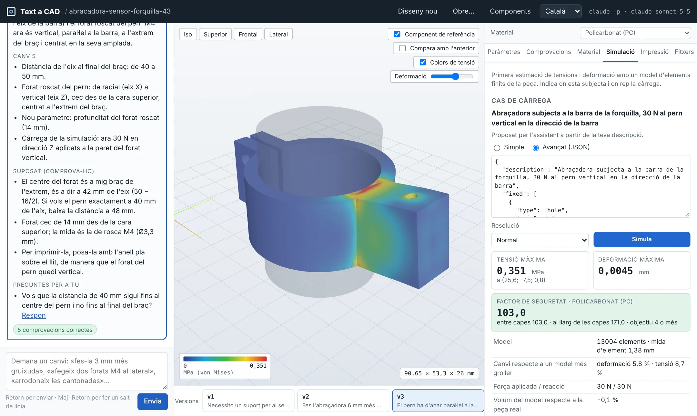
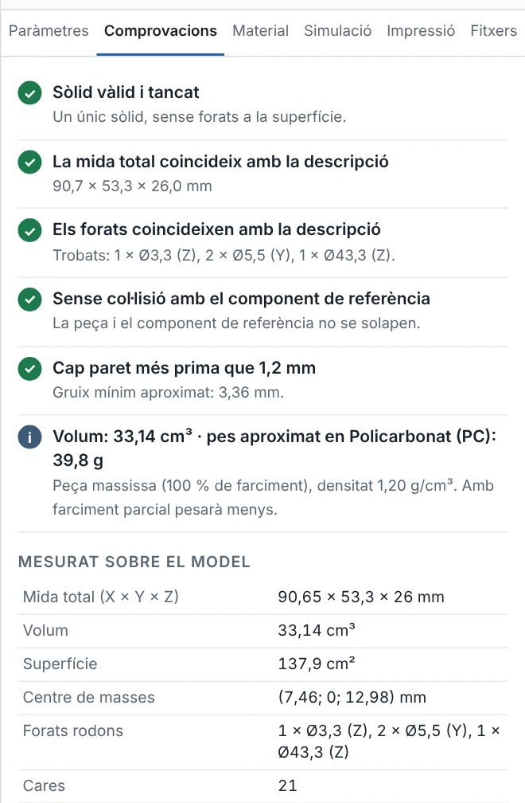
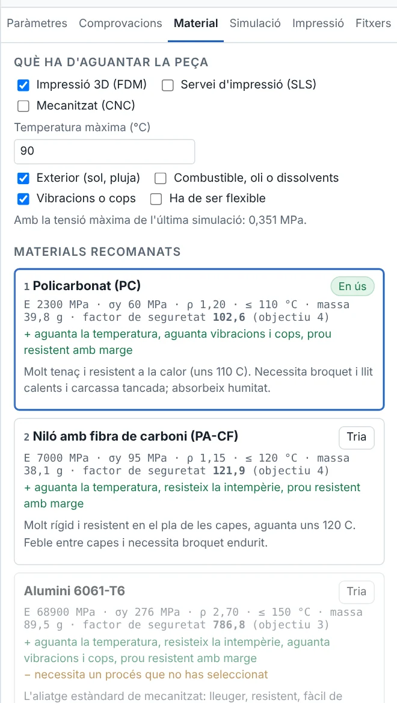
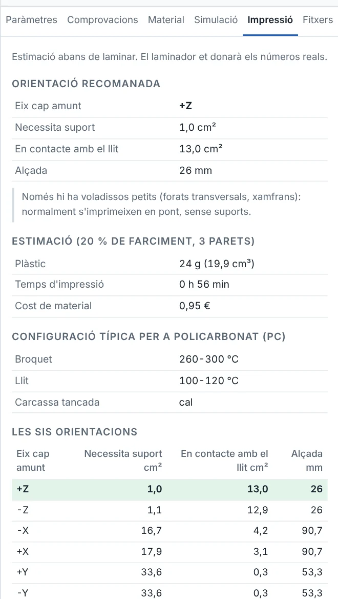

# Text a CAD

*[English version](README.md)*

Un assistent de disseny de peces mecàniques. Descriu la peça amb paraules, en
català, castellà o anglès, i en segons tens un model 3D paramètric. Després
continua parlant-hi: *«fes-la 6 mm més alta»*, *«afegeix-hi un segon cargol»*,
*«el pern ha d'anar paral·lel a la barra»*. Cada resposta és una versió nova
que pots comparar, comprovar, simular i baixar en **STEP** per a SolidWorks i en
**STL / 3MF** per a la impressora 3D.

Claude escriu un script de [CadQuery](https://cadquery.readthedocs.io) per a
cada versió. L'app l'executa al teu ordinador, mesura el sòlid real i et diu què
hi ha trobat.



## Què fa

- **Una conversa, no una sola petició.** El primer missatge crea la peça. Cada
  missatge següent modifica la versió actual i diu exactament què ha canviat.
  Les versions es guarden: pots tornar enrere o comparar-ne dues al visor.
- **S'explica.** Cada resposta porta un resum, la llista de canvis, els valors
  que ha hagut de suposar (perquè els comprovis) i les preguntes que et faria.
  Les pots respondre amb un clic.
- **Coneix components reals.** Escriu *«per a un cargol M5»*, *«un rodament
  608»*, *«un NEMA 17»* o *«el potenciòmetre lineal AiM de 75 mm»* i l'assistent
  rep les mides reals d'un catàleg de 67 components (cargols mètrics,
  rodaments, motors, potenciòmetres lineals, plaques, perfils, guies). En pots
  afegir de teus amb el botó **Components**.
- **Mesura el que ha construït.** Després de cada construcció es mesura el
  sòlid: mida total, cada forat cilíndric (diàmetre, eix, quants n'hi ha),
  parets, volum i pes. Si el resultat no és el que l'script prometia, l'error
  torna a Claude, que el corregeix (fins a 4 intents).
- **Peces que encaixen.** El tub, el sensor o el motor on va muntada la peça es
  mostra transparent i es comprova que no hi xoqui.
- **Controls lliscants.** Cada mida és un paràmetre. Moure un control regenera
  la peça al teu ordinador sense tornar a cridar Claude.
- **Materials.** 14 materials (PLA, PETG, ABS, ASA, PC, niló, niló amb carboni,
  TPU, alumini 6061 i 7075, acer, acer inoxidable, titani) ordenats segons l'ús
  que descrius: temperatura, exterior, fluids, vibracions i com la pots
  fabricar.
- **Simulació de tensions.** Un model d'elements finits al teu ordinador dona
  una primera estimació de tensió, deformació i factor de seguretat per al cas
  de càrrega, i pinta les tensions sobre la peça.
- **Impressió 3D.** Millor orientació al llit, suports, temps, plàstic i cost
  estimats, i en quines impressores habituals hi cap.
- **Fitxers.** STEP, STL, 3MF, l'script de CadQuery i una fitxa tècnica (una
  pàgina HTML amb la imatge, les mides, les comprovacions, el material i la
  simulació).

| Comprovacions | Material | Impressió |
|---|---|---|
|  |  |  |

L'exemple de les imatges és l'abraçadora que aguanta un sensor de recorregut
lineal a la forquilla d'una moto de MotoStudent.

## Requisits

- **Python 3.12** (Windows, macOS o Linux).
- Una d'aquestes maneres d'arribar a Claude:
  - **Claude Code** amb una subscripció Claude Pro o Max (per defecte, sense
    cost d'API): l'app executa `claude -p`. Instal·la'l seguint
    [la guia oficial](https://code.claude.com/docs/en/setup), executa `claude`
    una vegada en un terminal i inicia la sessió.
  - O bé una **clau de l'API d'Anthropic** (de pagament per ús).

## Inici ràpid (Windows)

Amb Python 3.12 i Claude Code instal·lats, **fes doble clic a `inicia.bat`**.
La primera vegada crea l'entorn de Python i instal·la les llibreries (uns
minuts). Les altres vegades obre l'app al navegador, a
`http://localhost:8765`. Per aturar-la, tanca la finestra negra.

## Instal·lació (pas a pas)

```bash
git clone https://github.com/jofreriusborrut-oss/text_a_CAD.git
```
```bash
cd text_a_CAD
```
```bash
py -3.12 -m venv .venv
```
```bash
.venv\Scripts\activate
```
```bash
pip install -r requirements.txt
```
```bash
copy .env.example .env
```
```bash
python server.py
```

A macOS i Linux fes servir `python3.12 -m venv .venv`,
`source .venv/bin/activate` i `cp .env.example .env`. Instal·lar CadQuery baixa
uns 300 MB.

## Com es fa servir

1. **Descriu la peça.** Digues per a què serveix i on va muntada, i després les
   mides que saps. L'assistent tria la resta i ho apunta a *Suposat
   (comprova-ho)*.
2. **Llegeix la resposta.** Repassa les suposicions, mira la peça i obre la
   pestanya **Comprovacions**.
3. **Demana canvis** al mateix quadre, tantes vegades com calgui. Amb *Compara
   amb l'anterior* veus què s'ha mogut.
4. **Afina amb els controls** de **Paràmetres**.
5. **Tria un material** a **Material** i **fes la simulació** a **Simulació**.
   L'assistent proposa el cas de càrrega a partir de la teva descripció; pots
   canviar on s'aguanta la peça i on rep la força.
6. **Mira Impressió** si l'has d'imprimir.
7. **Baixa-la** des de **Fitxers**. Obre l'STEP a SolidWorks amb
   *Archivo → Abrir* (*File → Open*), tipus de fitxer *STEP*. Les unitats són
   mil·límetres.

Els dissenys es guarden a `sortida/sessions/` (o a la carpeta de
`SESSIONS_DIR`), i *Obre…* recupera qualsevol disseny anterior amb totes les
versions.

### Com escriure bones descripcions

- Anomena components reals: *«M6»*, *«rodament 608»*, *«NEMA 17»*, *«perfil
  2020»*.
- Dona posicions a més de mides: *«4 forats de 6,5 mm a 10 mm de les vores»*.
- Digues quina força aguanta i com es fabricarà: *«aguanta 30 N a la punta»*,
  *«impresa en PETG»*, *«mecanitzada en alumini»*.
- Per a text en relleu o gravat digues el text, la mida i la cara.

### Des del terminal

```bash
python cli.py "Placa de 60 x 80 x 5 mm amb 4 forats M6 a 10 mm de les vores" --lang ca
```
```bash
python cli.py "Suport en L de 40 x 40 x 30 mm, 4 mm de gruix, dos forats M5" --material asa --simulate --lang ca
```
```bash
python cli.py --code tests/parts/a_placa.py
```

Cada execució escriu una carpeta a `sortida/` amb l'STEP, l'STL, el 3MF,
l'script i la fitxa tècnica. L'última ordre executa un script que ja tens, sense
Claude.

## Configuració (`.env`)

El fitxer `.env` guarda la teva configuració i no es puja mai a git.

| Variable | Per defecte | Què és |
|---|---|---|
| `CLAUDE_BACKEND` | `cli` | `cli` = `claude -p` (subscripció) · `api` = API d'Anthropic |
| `CLAUDE_MODEL` | `claude-sonnet-5-5` | Model que escriu els scripts |
| `ANTHROPIC_API_KEY` | *(buit)* | Només per a `CLAUDE_BACKEND=api` |
| `CLAUDE_CLI_PATH` | *(buit)* | Camí complet de `claude` si no és al PATH |
| `EXEC_TIMEOUT` | `30` | Segons per executar cada script |
| `CLAUDE_TIMEOUT` | `300` | Segons per a cada resposta de Claude |
| `MAX_ATTEMPTS` | `4` | Primera resposta més correccions, per a cada missatge |
| `SESSIONS_DIR` | `sortida/sessions` | On es guarden els dissenys |

Amb `CLAUDE_BACKEND=cli`, l'app treu `ANTHROPIC_API_KEY` de l'entorn de
`claude -p`, i per tant sempre fa servir la teva subscripció.

## Fins on et pots refiar dels números

- **La geometria** és exacta: és el mateix nucli de sòlids (OpenCascade) que fa
  servir FreeCAD, i el fitxer STEP és el B-rep real, no una malla.
- **Les comprovacions** comparen el sòlid mesurat amb el que declara l'script
  (mida i forats) i amb el component on encaixa. Detecten un element equivocat
  o que falta; no poden saber una mida que no has donat.
- **La simulació** és una eina de cribratge. La peça es talla en capses petites
  (de 3.000 a 30.000 elements): les cares corbes queden esglaonades i la tensió
  màxima a forats i cantonades interiors és només orientativa. Cada resultat
  indica quant ha canviat respecte a un model més gruixut. Per a peces
  impreses dona el factor de seguretat al llarg de les capes i entre capes.
  Fes-la servir per comparar versions i trobar el punt feble, no per donar per
  bona una peça de la qual depèn la seguretat d'algú.
- **Les dades dels materials** són valors típics de fitxes de fabricants. Les
  peces impreses canvien amb la impressora, la configuració i el filament.
- **El temps i el cost d'impressió** són estimacions per a un 20 % de farciment
  i 3 parets. Els números reals els dona el laminador.

## Tests i avaluació

```bash
pytest
```

Els tests no criden Claude. Cobreixen el format de les respostes, l'edició de
paràmetres, les comprovacions, els materials, la simulació (contra la teoria de
bigues) i el servidor. Els que necessiten CadQuery se salten si no està
instal·lat.

`eval/cases.json` conté 17 converses de disseny (34 missatges) amb les
respostes que Claude va donar de veritat: suports, un suport de rodament, un
engranatge, un colze de tub, una placa amb text, l'abraçadora del sensor de la
forquilla de MotoStudent. `tools/eval_run.py` les torna a executar amb el
CadQuery real i informa del que s'ha construït. A l'última execució 33
missatges van donar una peça vàlida, 32 al primer intent i un després d'una
correcció; el missatge que queda és una salutació, que l'assistent respon amb
preguntes en lloc d'una peça.

```bash
python tools/eval_run.py --out sortida/eval
```
```bash
python tools/eval_ask.py --pending sortida/eval/pending
```

La segona ordre demana a Claude les respostes que encara falten (casos nous o
correccions) i les enregistra.

## Com funciona

```
el teu missatge ──► petició = regles + exemples + dades de components + script actual
                         │
                         ▼
           Claude (claude -p o API) ──► nota per a tu + script de CadQuery
                         ▲                          │
                         │ què ha fallat            ▼
                         └──────── control de seguretat i execució en un procés a part
                                                    │
                    mesures, STEP, STL, 3MF ◄───────┘
                         │
   visor · versions · controls · comprovacions · materials · simulació · impressió · fitxers
```

Un script generat sempre té les mateixes parts:

```python
import cadquery as cq

PARAMS = {
    "length": {"value": 60, "unit": "mm", "min": 30, "max": 200, "label": "Llargada (X)"},
    # ... una entrada per cada mida
}

L = PARAMS["length"]["value"]
# ... geometria construïda només a partir de PARAMS ...
result = ...                              # el sòlid
EXPECTED_BBOX = (L, W, T)                 # mida total que ha de tenir la peça
EXPECTED_HOLES = [(6.6, 4)]               # forats rodons que ha de tenir
REFERENCE = ...                           # opcional: el component on encaixa
LOAD_CASE = {...}                         # opcional: on s'aguanta i on rep la força
```

| Fitxer | Què fa |
|---|---|
| `server.py` | Servidor web local (Flask) i la interfície de `textacad/static/` |
| `cli.py` | Interfície de terminal |
| `textacad/assistant.py` | Un torn de la conversa: petició, resposta, construcció, correccions |
| `textacad/prompts.py` | Regles, coneixement de disseny i exemples provats que s'envien a Claude |
| `textacad/protocol.py` | Llegeix la resposta etiquetada (nota + script) |
| `textacad/catalog.py`, `catalog_data.py` | Catàleg de components |
| `textacad/safety.py` | Rebutja els scripts que fan res més que construir geometria |
| `textacad/sandbox.py`, `runner.py` | Executen l'script en un procés a part, exporten i mesuren |
| `textacad/checks.py` | Comprovacions sobre el sòlid mesurat |
| `textacad/params.py`, `regenerate.py` | Controls: reescriuen `PARAMS` i regeneren |
| `textacad/materials.py` | Dades i classificació de materials |
| `textacad/voxel.py`, `fea.py`, `simulate.py` | Simulació per elements finits |
| `textacad/printability.py` | Orientació, suports, temps i cost |
| `textacad/report.py` | Fitxa tècnica |
| `textacad/session.py` | Dissenys i versions al disc |

**Nota de seguretat.** L'script generat s'executa al teu ordinador. Abans
d'executar-lo, l'app rebutja qualsevol script que importi res que no sigui
CadQuery i `math`, o que intenti llegir fitxers, fer servir la xarxa o engegar
programes. Després s'executa en un procés a part amb un límit de temps. És una
barrera de protecció, no un aïllament perfecte.

## Problemes habituals

- **`The claude command was not found`**: instal·la Claude Code i executa
  `claude` una vegada per iniciar la sessió, o posa `CLAUDE_CLI_PATH` al
  `.env`, o fes servir `CLAUDE_BACKEND=api`.
- **La primera peça triga molt**: la primera vegada, Python carrega
  OpenCascade (i el Windows Defender l'analitza). Això no compta per al límit
  de temps.
- **«Aquests valors no donen una peça vàlida»**: algunes combinacions dels
  controls són impossibles (un forat més gran que la placa). Es continua
  mostrant l'última peça vàlida.
- **«No he pogut construir una peça vàlida»**: després de 4 intents l'script
  encara falla. Demana la peça en passos més senzills: primer el cos principal
  i després els detalls, un missatge cada vegada.
- **La simulació diu que la peça no és un sòlid tancat**: demana a l'assistent
  que refaci l'element que ha fallat (normalment és text o una paret molt
  prima).

## Llicència

[MIT](LICENSE) © 2026 Jofre Rius Borrut. three.js (MIT) va inclòs a
`textacad/static/three`.
