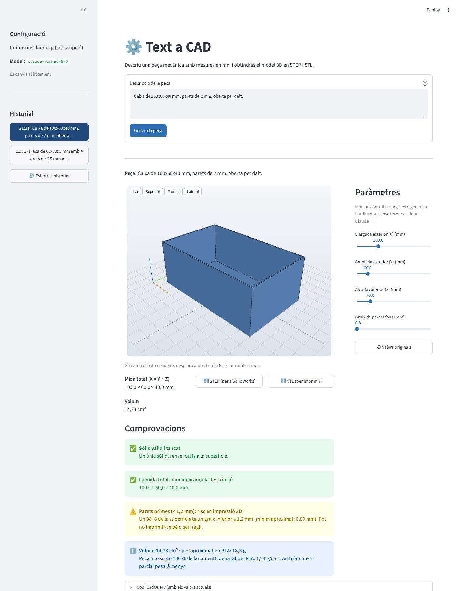

# Text a CAD

*[Versió en català](README.ca.md)*

Describe a mechanical part in plain text, with dimensions in millimetres, and get
a parametric 3D model you can view, tweak with sliders and download as **STEP**
(for SolidWorks, Fusion, FreeCAD…) and **STL** (for 3D printing).

Claude writes the [CadQuery](https://cadquery.readthedocs.io) code. The app
runs it in a separate process, checks the result and shows it in an interactive
3D viewer.



## Features

- **Text → 3D model**: e.g. *"Plate 60x80x5 mm with 4 holes of 6.5 mm at 10 mm
  from the edges and corners rounded with radius 4"*.
- **Self-correction**: if the code fails, the error goes back to Claude, which
  fixes it (up to 3 attempts). The app shows which attempt it is on.
- **Interactive 3D viewer** (three.js, works offline): rotate, pan, zoom, and
  Iso/Top/Front/Side views.
- **STEP and STL download**, plus the generated code in a collapsible section.
- **One slider per dimension**: every measure is in a `PARAMS` dictionary. When
  you move a slider, the part is rebuilt on your computer **without calling
  Claude again**.
- **Automatic checks**:
  - valid and closed solid;
  - overall size (bounding box) matches the description;
  - walls thinner than 1.2 mm (risky for 3D printing);
  - volume and approximate weight in PLA.
- **Chat with memory**: once the part exists, ask for changes in short sentences
  ("make the wall 8 mm thick", "add a centre hole"). The app sends Claude the
  conversation and the current part's code, and Claude edits only what you ask.
  You can also ask questions (material, weight, how to print it).
- **Assemblies of several parts**: ask for "an assembly", "with a separate lid" or
  "split it into components" and the STEP is written as an assembly: SolidWorks
  opens it with one component per part, each editable on its own. A ZIP with one
  STEP and one STL per part is also available, and the app warns when two parts
  interpenetrate.
- **Version history**: every change saves a version and you can go back to any.

## Requirements

- **Python 3.12** (Windows, macOS or Linux).
- One of these ways to reach Claude:
  - **Claude Code** with a Claude Pro/Max subscription (default, no API cost):
    the app runs `claude -p`. Install it following
    [the official guide](https://code.claude.com/docs/en/setup), then run
    `claude` once in a terminal and log in.
  - Or an **Anthropic API key** (pay per use).

## Quick start (Windows)

After installing Python 3.12 and Claude Code, **double-click `inicia.bat`**.
The first time it creates the Python environment and installs the libraries
(a few minutes). Every other time it just opens the app in your browser. Close
the black window to stop the app.

## Installation (Windows, step by step)

Open *PowerShell* (or the VS Code terminal) in the folder where you keep your
projects:

```bash
git clone https://github.com/jofreriusborrut-oss/text_a_CAD.git
```
```bash
cd text_a_CAD
```
```bash
py -3.12 -m venv .venv
```
```bash
.venv\Scripts\activate
```
```bash
pip install -r requirements.txt
```
```bash
copy .env.example .env
```

On macOS/Linux use `python3.12 -m venv .venv`, `source .venv/bin/activate` and
`cp .env.example .env`.

Installing CadQuery downloads about 300 MB and can take a few minutes.

## Configuration (`.env`)

The `.env` file holds your settings and is **never uploaded to git**
(it is listed in `.gitignore`).

| Variable | Default | Meaning |
|---|---|---|
| `CLAUDE_BACKEND` | `cli` | `cli` = `claude -p` (subscription) · `api` = Anthropic API |
| `CLAUDE_MODEL` | `claude-sonnet-5-5` | Model that writes the code |
| `ANTHROPIC_API_KEY` | *(empty)* | Only for `CLAUDE_BACKEND=api` |
| `CLAUDE_CLI_PATH` | *(empty)* | Full path to `claude` if it is not on the PATH |
| `EXEC_TIMEOUT` | `30` | Seconds allowed to run the CadQuery code |
| `CLAUDE_TIMEOUT` | `180` | Seconds allowed for each answer from Claude |

With `CLAUDE_BACKEND=cli`, the app removes `ANTHROPIC_API_KEY` from the
environment of `claude -p`, so it always uses your subscription.

## Usage

### Web app

```bash
streamlit run app.py
```

Your browser opens at `http://localhost:8501`.

1. Write the description of the part in the chat. Be precise: overall size,
   thicknesses, holes (diameter **and** position), fillets and chamfers.
2. Look at the part, read the checks, move the sliders and download STEP/STL.
3. Ask for changes in the same chat ("make it 10 mm longer", "remove the ribs").
   Each change is a new version in the history; **Peça nova** starts from scratch.
4. Open the STEP in SolidWorks (*File → Open*, type *STEP*).

<!-- Screenshot: generating a part (attempt 1/3, 2/3…) -->
<!--  -->

<!-- Screenshot: sliders -->
<!--  -->

<!-- Screenshot: the STEP opened in SolidWorks -->
<!--  -->

### Terminal

```bash
python cli.py "Plate 60x80x5 mm with 4 holes of 6.5 mm at 10 mm from the edges"
```

The STEP, STL and code are saved in `sortida/<name>/`. You can also run a
CadQuery file without Claude:

```bash
python cli.py --code tests/parts/a_placa.py
```

## Writing good descriptions

- Give the overall size as `length x width x height` (X × Y × Z).
- For holes give diameter and position: *"4 holes of 6.5 mm at 10 mm from the
  edges"*, or the screw size: *"3 M6 holes"* (clearance holes: M3 3.4, M4 4.5,
  M5 5.5, M6 6.6 mm).
- Say which edges are rounded or chamfered.
- If something is missing, Claude picks a sensible value and adds a slider for it.

## Tests

Tests that do **not** call Claude (hand-written CadQuery code, fake `claude`):

```bash
pytest
```

Real tests: the 5 reference descriptions in `tests/descripcions.py` are sent to
Claude and every one must give a valid part. The results go to
`sortida/tests/` so you can open them in SolidWorks.

```bash
$env:RUN_CLAUDE_TESTS=1; pytest tests/test_generacio.py -v
```

(On macOS/Linux: `RUN_CLAUDE_TESTS=1 pytest tests/test_generacio.py -v`.)

## How it works

```
description ──► Claude (claude -p or API) ──► CadQuery code with PARAMS
                     ▲                                │
                     │ error + code (max. 3 attempts) ▼
                     └──────────────── runner.py in a separate process (30 s)
                                                      │
                     STEP + STL + measurements ◄──────┘
                                │
          viewer · downloads · checks · sliders (rewrite PARAMS, rerun locally)
```

Generated code always has the same structure:

```python
import cadquery as cq

PARAMS = {
    "length": {"value": 60, "unit": "mm", "min": 30, "max": 200, "label": "Llargada (X)"},
    # ... one entry per dimension
}

L = PARAMS["length"]["value"]
# ... geometry built only from PARAMS ...
result = ...                       # the solid
EXPECTED_BBOX = (L, W, T)          # overall size expected from the description
```

| File | What it does |
|---|---|
| `app.py` | Streamlit interface |
| `cli.py` | Terminal interface |
| `textacad/prompts.py` | System prompt with the rules and 4 tested examples |
| `textacad/generator.py` | Talks to Claude and runs the correction loop |
| `textacad/sandbox.py`, `runner.py` | Run the code in a separate process with a time limit |
| `textacad/params.py` | Read and rewrite `PARAMS` (with Python's `ast`) |
| `textacad/regenerate.py` | Rebuild with new slider values |
| `textacad/checks.py` | Automatic checks |
| `textacad/viewer.py` | three.js 3D viewer |

**Security note:** the generated code runs on your computer, in a separate
process with a time limit. This protects the app from crashes and endless
loops, but it is not a full sandbox. The prompt forbids file and network access,
but treat the code like any script you download.

## Troubleshooting

- **`The claude command was not found`**: install Claude Code and run `claude`
  once to log in, or set `CLAUDE_CLI_PATH` in `.env` (for example
  `C:\Users\<you>\AppData\Roaming\npm\claude.cmd`), or use `CLAUDE_BACKEND=api`.
- **The first part takes a long time**: the first time, Python loads
  OpenCascade (and Windows Defender scans it). This loading time does not count
  towards the 30 s limit.
- **"This combination of values does not give a valid part"**: some slider
  combinations are impossible (e.g. holes bigger than the plate). The last valid
  part stays on screen.

## License

[MIT](LICENSE) © 2026 Jofre Rius Borrut. three.js (MIT) is included in
`textacad/static/three`.
