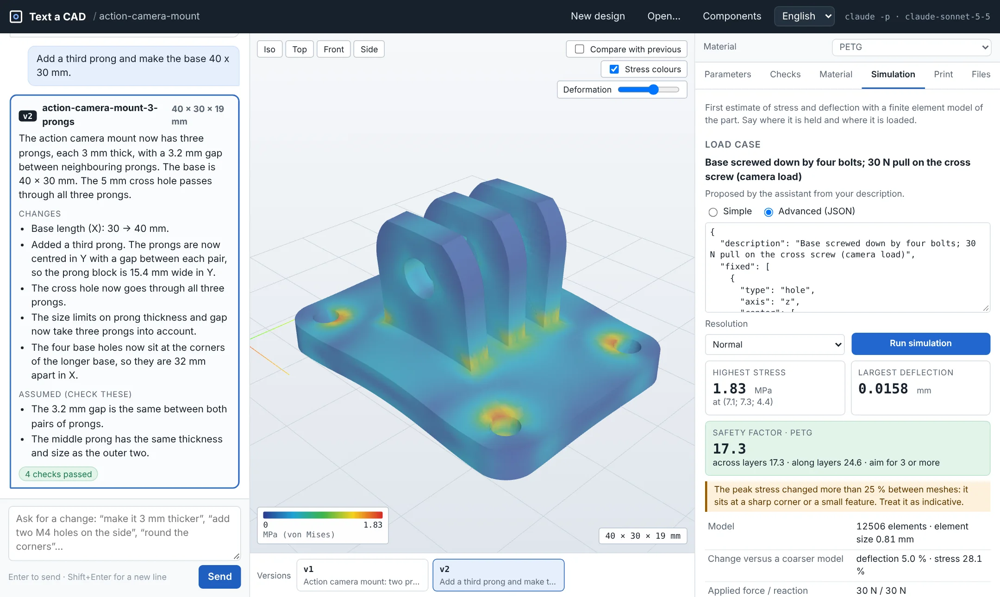
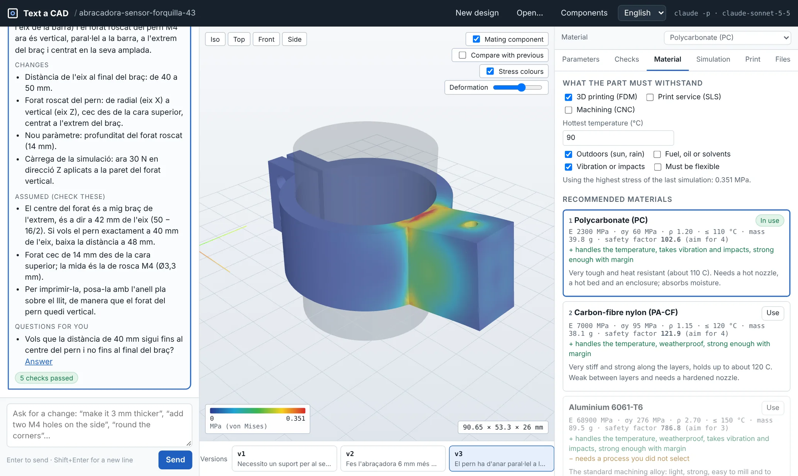
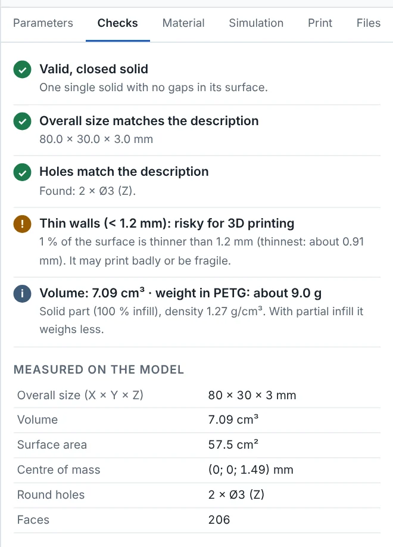
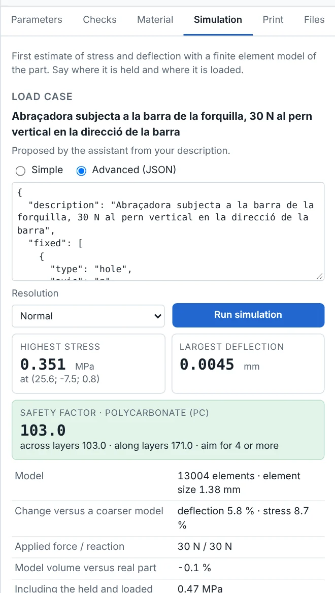
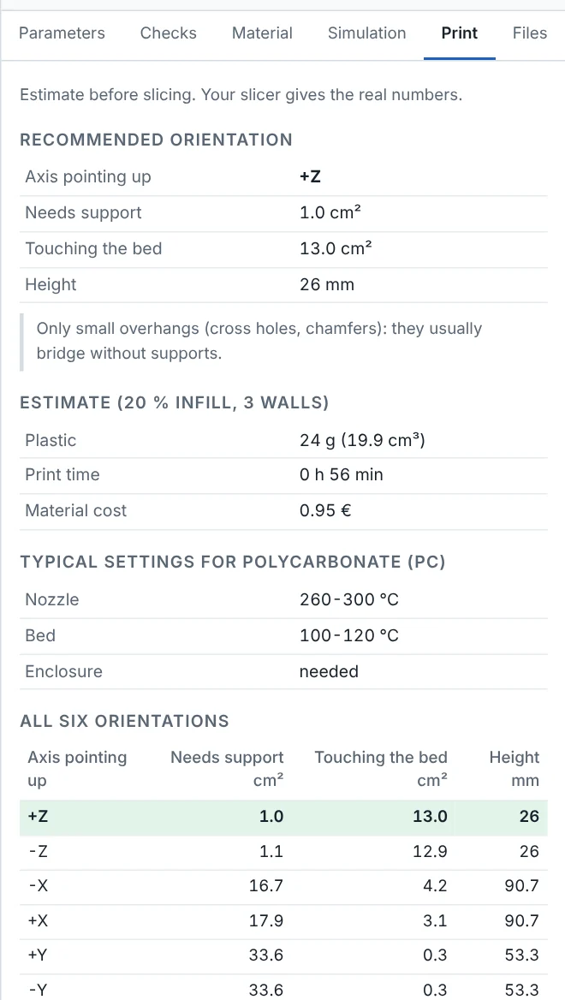

# Text a CAD

*[Versió en català](README.ca.md)*

A design assistant for mechanical parts. Describe the part in plain words, in
English, Catalan or Spanish, and get a parametric 3D model in seconds. Then keep
talking to it: *"make it 6 mm taller"*, *"add a second bolt"*, *"the stud must
be parallel to the tube"*. Every answer is a new version you can compare, check,
simulate and download as **STEP** for SolidWorks and **STL / 3MF** for a 3D
printer.

Claude writes a [CadQuery](https://cadquery.readthedocs.io) script for each
version. The app runs it on your computer, measures the real solid and tells you
what it found.



## What it does

- **A conversation, not a single prompt.** The first message creates the part.
  Every following message changes the current version and says exactly what
  changed. Versions are kept, so you can go back or compare two of them in the
  viewer.
- **It explains itself.** Each answer has a summary, the list of changes, the
  values it had to assume (so you can check them) and the questions it would ask
  you. Answer a question with one click.
- **It knows real components.** Write *"for an M5 screw"*, *"a 608 bearing"*,
  *"a NEMA 17"* or *"the AiM 75 mm linear potentiometer"* and the assistant gets
  the real dimensions from a catalogue of 67 components (metric fasteners,
  bearings, motors, linear potentiometers, boards, profiles, rails). You can add
  your own from the **Components** button.
- **It measures what it built.** The solid is measured after every build:
  overall size, every cylindrical hole (diameter, axis, how many), walls, volume
  and weight. If the result does not match what the script promised, the error
  goes back to Claude, which corrects it (up to 4 attempts).
- **Mating parts.** The tube, sensor or motor the part fits on is shown as a
  ghost and checked for collisions.
- **Sliders.** Every dimension is a parameter. Moving a slider rebuilds the part
  on your computer without calling Claude again.
- **Materials.** 14 materials (PLA, PETG, ABS, ASA, PC, nylon, carbon nylon,
  TPU, aluminium 6061 and 7075, steel, stainless steel, titanium) ranked for the
  use you describe: temperature, outdoors, fluids, vibration, process available.
- **Stress simulation.** A finite element model on your computer gives a first
  estimate of stress, deflection and safety factor for the load case, and paints
  the stress on the part.
- **3D printing.** Best orientation on the bed, supports, estimated time, plastic
  and cost, and which common printers it fits in.
- **Files.** STEP, STL, 3MF, the CadQuery script and a technical sheet (one HTML
  page with the picture, dimensions, checks, material and simulation).



This clamp holds a linear travel sensor on the fork of a MotoStudent bike. It was
asked for in Catalan, so the assistant answers in Catalan while the interface
stays in the language you choose.

| Checks | Simulation | Printing |
|---|---|---|
|  |  |  |

## Requirements

- **Python 3.12** (Windows, macOS or Linux).
- One of these ways to reach Claude:
  - **Claude Code** with a Claude Pro or Max subscription (default, no API
    cost): the app runs `claude -p`. Install it following
    [the official guide](https://code.claude.com/docs/en/setup), then run
    `claude` once in a terminal and log in.
  - Or an **Anthropic API key** (pay per use).

## Quick start (Windows)

After installing Python 3.12 and Claude Code, **double-click `inicia.bat`**.
The first time it creates the Python environment and installs the libraries
(a few minutes). Every other time it opens the app in your browser at
`http://localhost:8765`. Close the black window to stop the app.

## Installation (step by step)

```bash
git clone https://github.com/jofreriusborrut-oss/text_a_CAD.git
```
```bash
cd text_a_CAD
```
```bash
py -3.12 -m venv .venv
```
```bash
.venv\Scripts\activate
```
```bash
pip install -r requirements.txt
```
```bash
copy .env.example .env
```
```bash
python server.py
```

On macOS and Linux use `python3.12 -m venv .venv`, `source .venv/bin/activate`
and `cp .env.example .env`. Installing CadQuery downloads about 300 MB.

## Using it

1. **Describe the part.** Say what it is for and what it fits on, then the
   sizes you know. The assistant chooses the rest and lists it under *Assumed*.
2. **Read the answer.** Check the assumptions, look at the part, open the
   **Checks** tab.
3. **Ask for changes** in the same box, as many times as you need. Use
   *Compare with previous* to see what moved.
4. **Fine-tune with the sliders** in **Parameters**.
5. **Choose a material** in **Material** and **run the simulation** in
   **Simulation**. The assistant proposes the load case from your description;
   you can change where the part is held and where it is loaded.
6. **Look at Print** if you are going to print it.
7. **Download** from **Files**. Open the STEP in SolidWorks with
   *File → Open*, file type *STEP*. Units are millimetres.

Designs are saved in `sortida/sessions/` (or the folder in `SESSIONS_DIR`), so
*Open…* brings back any earlier design with all its versions.

### Writing good descriptions

- Name real components: *"M6"*, *"608 bearing"*, *"NEMA 17"*, *"2020 profile"*.
- Give positions as well as sizes: *"4 holes of 6.5 mm, 10 mm from the edges"*.
- Say how it is loaded and how it will be made: *"it holds 30 N at the tip"*,
  *"printed in PETG"*, *"machined in aluminium"*.
- For raised or engraved text say the text, its size and the face.

### From the terminal

```bash
python cli.py "Plate 60 x 80 x 5 mm with 4 M6 holes 10 mm from the edges"
```
```bash
python cli.py "L bracket 40 x 40 x 30 mm, 4 mm thick, two M5 holes" --material asa --simulate --lang en
```
```bash
python cli.py --code tests/parts/a_placa.py
```

Each run writes a folder in `sortida/` with STEP, STL, 3MF, the script and the
technical sheet. The last command runs a script you already have, without
Claude.

## Configuration (`.env`)

The `.env` file holds your settings and is never uploaded to git.

| Variable | Default | Meaning |
|---|---|---|
| `CLAUDE_BACKEND` | `cli` | `cli` = `claude -p` (subscription) · `api` = Anthropic API |
| `CLAUDE_MODEL` | `claude-sonnet-5-5` | Model that writes the scripts |
| `ANTHROPIC_API_KEY` | *(empty)* | Only for `CLAUDE_BACKEND=api` |
| `CLAUDE_CLI_PATH` | *(empty)* | Full path to `claude` if it is not on the PATH |
| `EXEC_TIMEOUT` | `30` | Seconds allowed to run each script |
| `CLAUDE_TIMEOUT` | `300` | Seconds allowed for each answer from Claude |
| `MAX_ATTEMPTS` | `4` | First answer plus corrections, for each message |
| `SESSIONS_DIR` | `sortida/sessions` | Where the designs are saved |

With `CLAUDE_BACKEND=cli`, the app removes `ANTHROPIC_API_KEY` from the
environment of `claude -p`, so it always uses your subscription.

## How far to trust the numbers

- **Geometry** is exact: it is the same solid kernel (OpenCascade) that FreeCAD
  uses, and the STEP file is the real B-rep, not a mesh.
- **Checks** compare the measured solid with what the script declares (size and
  holes) and with the mating component. They catch a wrong or missing feature;
  they cannot know a dimension you never gave.
- **Simulation** is a screening tool. The part is cut into small boxes
  (3,000 to 30,000 elements), so curved faces become steps and the peak stress
  at holes and inner corners is only indicative. Each result shows how much it
  changed against a coarser model. For printed parts it reports the safety
  factor along and across the layers. Use it to compare versions and find the
  weak spot, not to sign off a part that someone's safety depends on.
- **Material data** are typical values from manufacturers' data sheets. Printed
  parts vary with the printer, the settings and the filament.
- **Print time and cost** are estimates for 20 % infill and 3 walls. The slicer
  gives the real numbers.

## Tests and evaluation

```bash
pytest
```

The tests do not call Claude. They cover the answer format, the parameter
editing, the checks, the materials, the simulation (against beam theory) and the
server. The ones that need CadQuery are skipped if it is not installed.

`eval/cases.json` holds 17 design conversations (34 messages) with the answers
Claude really gave: brackets, a bearing support, a gear, a pipe elbow, a name
plate with text, the MotoStudent fork sensor clamp. `tools/eval_run.py` replays
them on the real CadQuery and reports what was built. On the last run 33
messages gave a valid part, 32 of them at the first attempt and one after a
correction; the remaining message is a greeting, which the assistant answers
with questions instead of a part.

```bash
python tools/eval_run.py --out sortida/eval
```
```bash
python tools/eval_ask.py --pending sortida/eval/pending
```

The second command asks Claude for the answers that are still missing (new
cases, or corrections) and records them.

## How it works

```
your message ──► request = rules + examples + component data + current script
                      │
                      ▼
        Claude (claude -p or API) ──► note for you + CadQuery script
                      ▲                          │
                      │ what failed              ▼
                      └──────────── safety check, then run in a separate process
                                                 │
                 measurements, STEP, STL, 3MF ◄──┘
                      │
   viewer · versions · sliders · checks · materials · simulation · print · files
```

A generated script always has the same parts:

```python
import cadquery as cq

PARAMS = {
    "length": {"value": 60, "unit": "mm", "min": 30, "max": 200, "label": "Length (X)"},
    # ... one entry per dimension
}

L = PARAMS["length"]["value"]
# ... geometry built only from PARAMS ...
result = ...                              # the solid
EXPECTED_BBOX = (L, W, T)                 # overall size the part must have
EXPECTED_HOLES = [(6.6, 4)]               # round holes it must have
REFERENCE = ...                           # optional: the component it fits on
LOAD_CASE = {...}                         # optional: where it is held and loaded
```

| File | What it does |
|---|---|
| `server.py` | Local web server (Flask) and the interface in `textacad/static/` |
| `cli.py` | Terminal interface |
| `textacad/assistant.py` | One turn of the conversation: request, answer, build, corrections |
| `textacad/prompts.py` | Rules, design knowledge and tested examples sent to Claude |
| `textacad/protocol.py` | Reads the tagged answer (note + script) |
| `textacad/catalog.py`, `catalog_data.py` | Component catalogue |
| `textacad/safety.py` | Refuses scripts that do more than build geometry |
| `textacad/sandbox.py`, `runner.py` | Run the script in a separate process, export and measure |
| `textacad/checks.py` | Checks on the measured solid |
| `textacad/params.py`, `regenerate.py` | Sliders: rewrite `PARAMS` and rebuild |
| `textacad/materials.py` | Material data and ranking |
| `textacad/voxel.py`, `fea.py`, `simulate.py` | Finite element simulation |
| `textacad/printability.py` | Orientation, supports, time and cost |
| `textacad/report.py` | Technical sheet |
| `textacad/session.py` | Designs and versions on disk |

**Security note.** The generated script runs on your computer. Before running,
the app refuses any script that imports anything other than CadQuery and `math`,
or that tries to read files, use the network or start programs. It then runs in
a separate process with a time limit. This is a guard rail, not a perfect
sandbox.

## Troubleshooting

- **`The claude command was not found`**: install Claude Code and run `claude`
  once to log in, or set `CLAUDE_CLI_PATH` in `.env`, or use
  `CLAUDE_BACKEND=api`.
- **The first part takes a long time**: the first time, Python loads
  OpenCascade (and Windows Defender scans it). This does not count towards the
  time limit.
- **"These values do not give a valid part"**: some slider combinations are
  impossible (a hole bigger than the plate). The last valid part stays on
  screen.
- **"I could not build a valid part"**: after 4 attempts the script still
  fails. Ask for the part in simpler steps: the main body first, then the
  details one message at a time.
- **The simulation says the part is not a closed solid**: ask the assistant to
  rebuild the feature that failed (it is usually text or a very thin wall).

## License

[MIT](LICENSE) © 2026 Jofre Rius Borrut. three.js (MIT) is included in
`textacad/static/three`.
